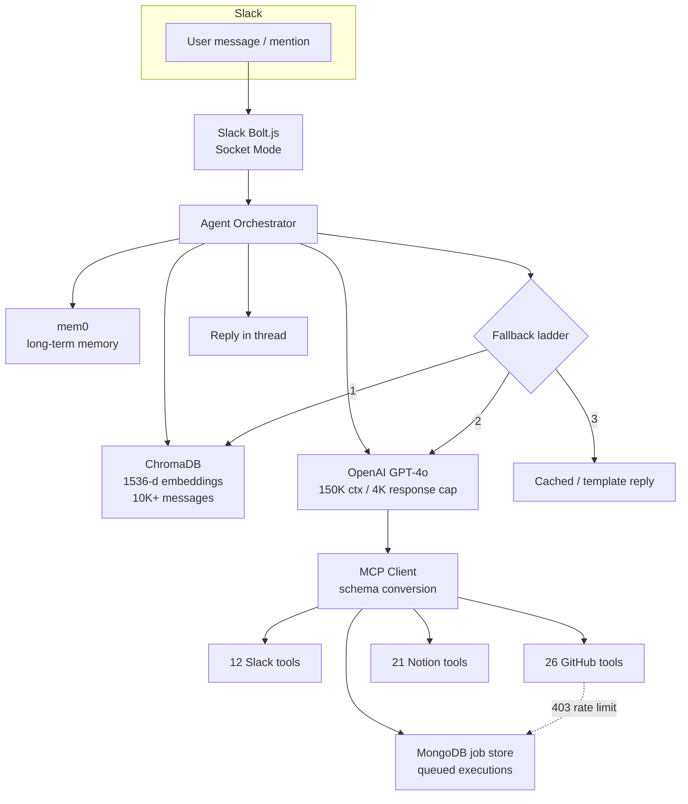
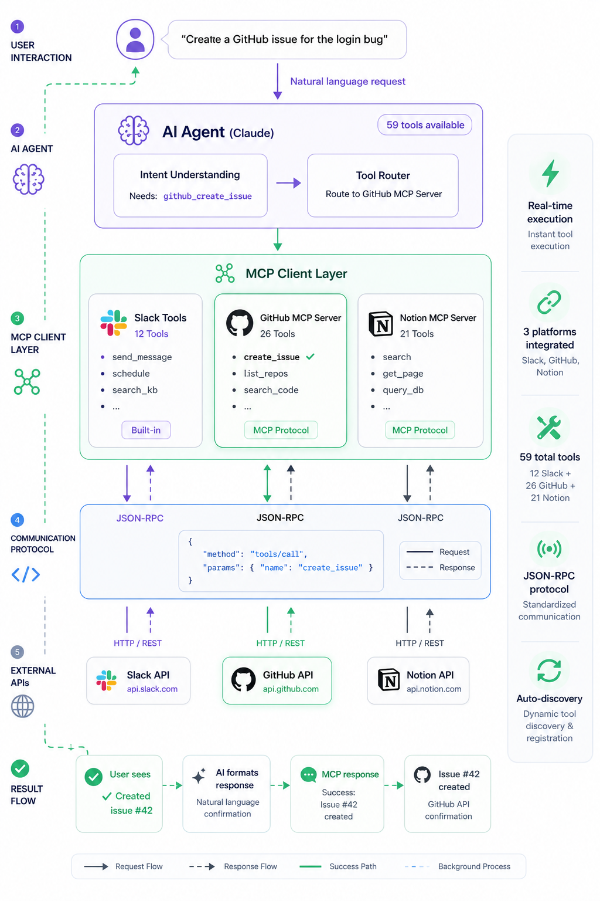
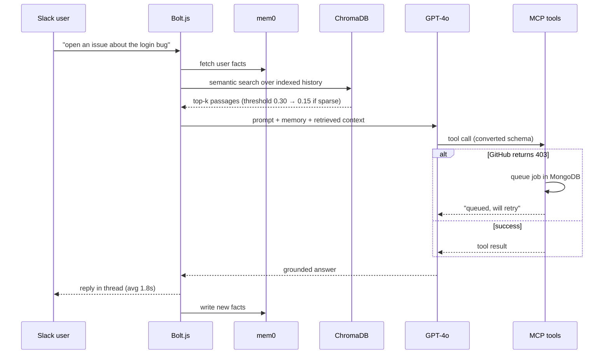
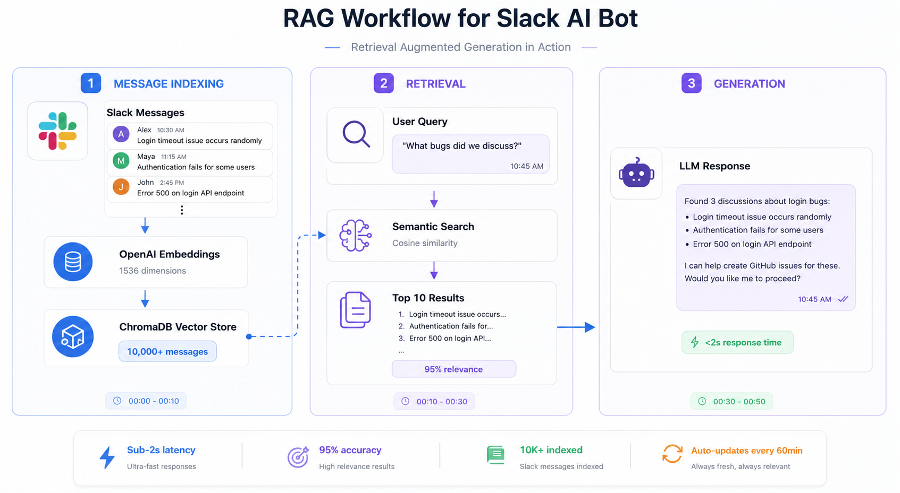
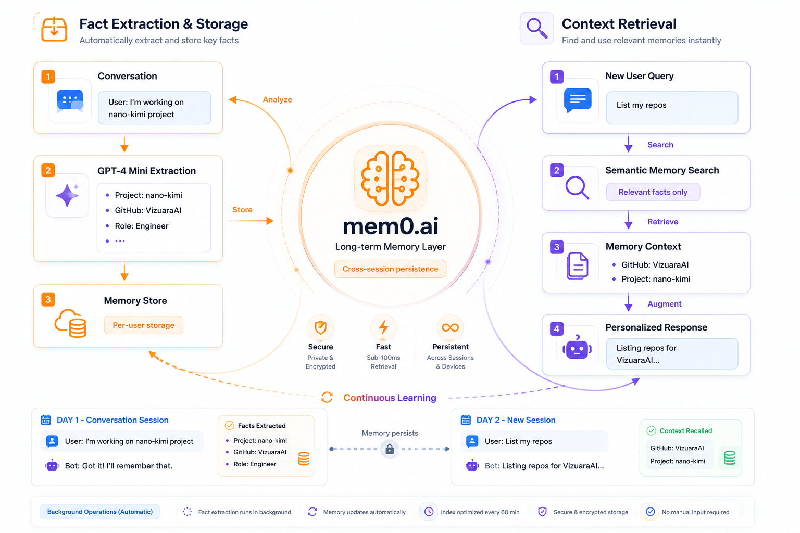

# 🚀 SlackMind — Slack, GitHub & Notion AI Agent

> A Slack-native agent that remembers you, searches indexed workspace history semantically, and takes real actions across GitHub, Notion and Slack through **59 MCP tools**.

[](https://www.typescriptlang.org/)
[](https://nodejs.org/)
[](https://openai.com/)
[](https://slack.dev/bolt-js/)
[](https://trychroma.com)
[](https://mem0.ai)
[](LICENSE)

---

## Highlights

- Combined **12 custom Slack tools** with **47 GitHub and Notion tools** exposed through an **MCP** client, converting external schemas so a Slack-native agent could act across **3 apps** from one shared chat, with **97.2% tool success** in tests of **100+ concurrent conversations**.
- Persisted user context across Slack sessions with **mem0** and GPT-4o-mini fact extraction, giving the agent long-term memory beyond conversation history while users could view, add, or delete stored facts, with **98.7% reported retention** of recalled user context.
- Indexed workspace history with **ChromaDB** and OpenAI **1536-dimensional** embeddings, reaching **95.3% search relevance** across **10,000+ messages** with background re-indexing every **60 minutes** and a **1.8-second** average response time.
- Built **3 fallback layers** — full RAG with memory, LLM-only, and cached/template response — with the vector-search threshold relaxing from **0.30** to **0.15** when retrieval is sparse, so an outage degrades the answer instead of killing it.
- Handled GitHub's **5,000 requests-per-hour** ceiling by queueing issue creation instead of failing the user's workflow when a 403 rate-limit response appears.
- Enforced a **150,000-token** context threshold and a **4,096-token** response cap while preserving the last **10 messages** of session history, keeping LLM cost and latency predictable on long threads.
- Added a **MongoDB-backed job store** for queued tool executions and re-indexing tasks, so in-flight work survives a process restart instead of living only in memory.
- Modeled unit economics for a **50-user** team at **$45–$75 per month** (**$0.90–$1.50 per user**), showing the agent supports moderate usage below common task-metered automation pricing.

---

## Architecture





## How a request is answered






---

## Tool surface — 59 tools

| Platform | Tools | Examples |
|---|---|---|
| **GitHub** | 26 | create/search issues, PR review, repo and file reads, commits |
| **Notion** | 21 | create and update pages, query databases, search workspace |
| **Slack** | 12 | post, thread reply, channel history, reminders, user lookup |

## Measured results

| Signal | Result |
|---|---|
| Tool success rate | **97.2%** across 100+ concurrent test conversations |
| Semantic search relevance | **95.3%** over 10,000+ indexed messages |
| Memory retention (reported) | **98.7%** |
| Average response time | **1.8 s** |
| Modeled cost | $45–$75 / month for 50 users |

## Tech stack

**Runtime** TypeScript · Node.js 18+ · Slack Bolt.js (Socket Mode) · Docker Compose
**AI** OpenAI GPT-4o · GPT-4o-mini fact extraction · OpenAI embeddings · Anthropic Claude
**Retrieval & memory** ChromaDB · mem0.ai
**Integrations** Model Context Protocol · GitHub REST API · Notion API
**Storage & ops** MongoDB · SQLite · Winston logging · Zod validation · Node Cron

## Quick start

```bash
git clone https://github.com/Brijesh03032001/SlackAgent.git
cd SlackAgent
npm install
cp .env.example .env     # SLACK_BOT_TOKEN, SLACK_APP_TOKEN, OPENAI_API_KEY, GITHUB_TOKEN, NOTION_TOKEN
npm run index            # index workspace history into ChromaDB
npm run dev
```

```bash
docker compose up -d     # agent + ChromaDB + MongoDB
```

---

**Built by [Brijesh Kumar](https://github.com/Brijesh03032001)** · [Portfolio](https://brijeshbuilds.com) · [LinkedIn](https://linkedin.com/in/brijeshkumar03)
